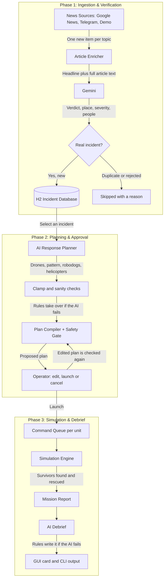

# FleetOps: AI-Planned Multi-Robot Rescue Simulation

[](https://openjdk.org/)
[](https://maven.apache.org/)
[](https://www.formdev.com/flatlaf/)
[](https://h2database.com/)
[](https://ai.google.dev/)
[](https://picocli.info/)

------------------------------------------------------------------------

## Overview

FleetOps is a multi-agent rescue simulation. It reads disaster news, uses a **Large Language Model
(LLM)** to verify each story and plan a response, checks every action with a deterministic safety
gate, and plays the rescue out on a live map with drones, robodogs, rovers and helicopters.

It moves from raw news, to AI verification, to an AI-written mission plan, to **human approval**, to
a simulated rescue, to an AI debrief. It is a playful simulation, not software for controlling real
robots.


<!-- Placeholder: record the map window and save it as docs/demo.gif. -->

The program works with no key and no network: the defaults use a mock AI and a built-in set of demo
stories.

------------------------------------------------------------------------

## System Flow Diagram



------------------------------------------------------------------------

## Core Competencies & Implementation

### 1. Prompt Engineering & LLM Reliability

- Role-based prompts for three jobs: verifying news, planning a response and writing a debrief.
- Strict JSON answers: every model reply is parsed and validated, a bad reply gets one repair attempt, and a second bad reply falls back to fixed rules.
- Untrusted text is fenced: article text is passed as data, never as instructions.
- The AI proposes and the program decides: unit counts are clamped to what is ready, at least one helicopter is always planned when people are expected, and the plan says when it changed the AI's numbers.
- Debriefs are written from the program's own numbers. Claims about zero counts ("nobody was left behind") are filtered out, and a debrief must always include next-time lessons.

### 2. News Pipeline

- Topics: flood, famine, fire, earthquake. One unseen item per topic per scan.
- Google News links are decoded to the real article, and the article text is downloaded so the AI reads more than a headline. If any step fails, the headline and short description are used instead.
- Outlet names are stripped from headlines (" - CBC" and similar).
- Several feeds act as one source, in the order you list them: the first listed feed is read first, so `NEWS_SOURCES=google,demo` scans real news before the demo stories.
- Duplicates are caught by a normalised source key that is unique in the database.

### 3. Deterministic Safety & Simulation

- A safety gate checks every command from the AI or the operator for battery reserve, service area and unit readiness before it runs.
- Fixed one-second ticks and a seeded random generator make runs repeatable.
- Commands for one unit run in order, different units run in parallel, and a failed command cancels the rest of that unit's queue.

------------------------------------------------------------------------

## The 3-Step Pipeline

### 1. Scan & Verify

- Collects news, enriches it with article text, and has the AI decide if it is a real incident
- Extracts place, latitude/longitude, severity and people affected
- Stores new incidents and skips duplicates

### 2. Plan & Approve

- The AI chooses drones, search pattern (lawnmower or spiral), robodogs and helicopters
- The operator can edit any number and the plan is checked again; **Launch** stays disabled if it cannot be carried out
- Fixed rules take over if the AI is unavailable

### 3. Simulate & Debrief

- A rover drives to the incident, drones sweep the area and reveal people, robodogs are dropped off and walk circles to find people close to the ground, helicopters carry them out
- The AI writes a short debrief: summary, what went well, problems and what to do next time

------------------------------------------------------------------------

## Command Reference

### Command line

Every command is run as `mvn -q exec:java -Dexec.mainClass=com.fleetops.cli.FleetOpsCli -Dexec.args="<command>"`.

| Command | What it does |
|---|---|
| `config` | Show the effective configuration (keys are never printed) |
| `scan [-t flood,fire] [-v]` | Read one new news item per topic, have the AI verify it, store new incidents |
| `incidents [-a] [-s STATE] [-t TYPE]` | List incidents (active ones unless `-a` or `-s`) |
| `show <id>` | Details of one incident |
| `run <id> [--dry-run] [-y] [--progress] [--abort-after S] [--no-debrief]` | AI plans the response, you approve it, the simulation plays out and prints a report and a debrief |
| `reset [-f] [-y]` | Delete stored incidents (`-f`: only finished ones), after confirmation |

`run` also takes `--rovers`, `--drones`, `--robodogs`, `--helicopters`, `--depot-km`, `--seed` and
`--max-ticks`; these set the size of the fleet (drones and robodogs are per rover).

**Changing the plan.** Before it asks for approval, `run` can change what the AI chose:
`--send-drones N`, `--send-robodogs N` (0 for none), `--send-helicopters N` and `--pattern lawnmower|spiral`.
The changed plan is compiled and checked again, and refused with a reason if the batteries or the
rover's range cannot cover it. The plan text then says what the operator changed.

Exit codes: 0 ok, 1 configuration error, 2 bad usage, 3 incident not found, 4 failed or not completed.

Example session with the offline demo news:

```
scan
incidents
run 1 --progress
run 2 --send-drones 3 --send-robodogs 1 --pattern spiral --dry-run
```

### Graphical interface

`mvn -q exec:java` opens the map window (dark map tiles, so it needs internet access to show the map).

**Layout.** The header has presets (**Map**, **Map + list**, **Control**) and buttons to hide the sidebar and the console. Drag the dividers to resize either; the sizes are remembered.

**Working with incidents.**
1. **Scan news** (or `scan` in the console) reads the configured feeds, has the AI verify them and adds incidents to the sidebar cards and the map.
2. Click a card or a map marker to select it. A floating card on the map shows the incident and its mission.
3. Press **Plan mission**, read the plan and press **Launch**. The rover drives to the edge of the square, drones sweep it (found people appear as red dots), robodogs walk circles around their drop-off points (shown as faint circles) and helicopters carry people out (rescued people turn green).
4. The plan window has an **Adjust the plan** section: change the number of drones, the search pattern, the number of robodogs and the number of helicopters. The plan is worked out and checked again after each change; if it cannot be carried out the reason is shown and **Launch** stays disabled. **Back to original plan** restores the AI's choice.
5. **Abort** stops a mission and brings the units home. In the sidebar, **Abort all**, **Reset fleet** and **Clear finished** manage the rest, and the speed box sets how fast simulated time runs. The **Fleet** row sets rovers, drones per rover, robodogs per rover, helicopters and the simulation speed.
6. When a mission ends, its card on the map shows the AI's debrief (summary, what went well, problems, next time). The console command `debrief [id]` prints it again.

**Console.** The panel at the bottom runs the same commands as the command line against the same database (`scan`, `incidents`, `show <id>`, `run <id>`, `reset`, `config`). Up/Down recalls history, Tab completes, Ctrl+L clears. These commands also drive the window:

| Command | Effect |
|---|---|
| `plan <id>` | plan a verified incident and print the plan |
| `edit [drones=N] [pattern=lawnmower\|spiral] [helicopters=N] [robodogs=N]` | change the plan that is waiting; `edit reset` goes back to the AI's plan |
| `launch` / `cancel` | start or drop the plan that is waiting |
| `debrief [id]` | show the debrief of a finished mission (default: the selected one) |
| `abort [id\|all]` | stop one mission (default: the selected one) or all |
| `focus <id\|all>` | select an incident and zoom the map to it |
| `speed [n]` | show or set the simulation speed |
| `fleet [r d h [dogs]]` | show or set rovers, drones per rover, helicopters and robodogs per rover |
| `layout <map\|list\|control\|sidebar\|console>` | change the window layout |
| `help`, `clear`, `exit` | list commands, clear the screen, hide the console |

In IntelliJ you can also run `FleetOpsGui` or `FleetOpsCli` directly from their `main` methods.

------------------------------------------------------------------------

## Getting Started

### Prerequisites

- Java 21 or newer (`java -version`)
- Maven 3.9+ (IntelliJ IDEA bundles one; for the terminal, install it with `brew install maven`)

### Clone the Repository

``` bash
git clone https://github.com/abhisheksaraff/fleet-ops.git
cd fleet-ops
```

### Environment Configuration

Secrets live in a local `.env` file that is **gitignored**. Never commit a real API key.

``` bash
cp .env.example .env
```

The default `LLM_PROVIDER=mock` needs no key and no network. To use Gemini, set `LLM_PROVIDER=gemini`
and put your key from [Google AI Studio](https://aistudio.google.com/) in `LLM_API_KEY`. A typical
setup with real news and Gemini looks like this (with your own keys):

``` env
LLM_PROVIDER=gemini
LLM_API_KEY=YOUR_LOCAL_API_KEY_HERE
NEWS_SOURCES=google,demo
MAP_TILES=dark
CARTO_API_KEY=YOUR_FREE_CARTO_KEY_OR_LEAVE_BLANK
```

| Key | Meaning | Default |
|---|---|---|
| `LLM_PROVIDER` | `mock`, `gemini` or `ollama` | `mock` |
| `LLM_API_KEY` | API key (required for `gemini`) | none |
| `LLM_MODEL` | Model name | provider default |
| `LLM_FALLBACK_MODELS` | Gemini only: other models to try, in order, when the main one has used up its free daily allowance (e.g. `gemini-2.5-flash-lite`) | none |
| `LLM_BASE_URL` | Ollama server URL | `http://localhost:11434` |
| `DB_URL` | JDBC URL of the incident database, or `memory` for no saving | `jdbc:h2:./data/fleetops` |
| `DB_USER` / `DB_PASSWORD` | Database login (only needed outside the embedded H2 default) | `sa` / empty |
| `NEWS_SOURCES` | `demo`, `google`, `telegram` (comma separated, read in the order listed) | `demo` |
| `TELEGRAM_CHANNELS` | Public channel names, used when `telegram` is a source | none |
| `NEWS_GOOGLE_EDITION` | Google News language and country | `hl=en-CA&gl=CA&ceid=CA:en` |
| `NEWS_TOPICS` | `flood`, `famine`, `fire`, `earthquake` (blank = all four) | all four |
| `MAP_TILES` | Map tile source: `dark` (CARTO Dark Matter, needs `CARTO_API_KEY`) or `osm` (OpenStreetMap) | `dark` |
| `CARTO_API_KEY` | Free CARTO basemap key from [carto.com/basemaps/apikey](https://carto.com/basemaps/apikey); without it `dark` falls back to OpenStreetMap | none |

### Build and Run

``` bash
mvn -q compile                             # build (downloads dependencies the first time)
mvn -q exec:java                           # start the GUI
mvn -q exec:java -Dexec.mainClass=com.fleetops.cli.FleetOpsCli -Dexec.args="config"   # CLI
```

------------------------------------------------------------------------

## Design

The core (incidents, fleet, simulation, commands, safety gate, mission control) depends only on
interfaces. Vendors (Gemini/Ollama, H2, the map library, news sources) sit behind adapters, and
`AppContext` is the one place that chooses which implementation to use, so any of them can be
swapped through configuration:

| To change | Edit |
|---|---|
| AI vendor | `LLM_PROVIDER` in `.env`; a new vendor is one class implementing `LlmClient` plus one line in `LlmClients` |
| Database | `DB_URL` (and the driver dependency in `pom.xml`); the code only uses `java.sql` |
| News feeds | `NEWS_SOURCES`; a new feed is one class implementing `NewsSource` |
| Map tiles | `MapTiles` (`dark` and `osm`) |

The design patterns used, with the classes that implement them, are listed in
[docs/ARCHITECTURE.md](docs/ARCHITECTURE.md).

------------------------------------------------------------------------

## Project Structure

Package overview (`src/main/java/com/fleetops/`):

| Package | Role |
|---|---|
| `domain` | Incidents, survivors, geography and the fleet (rover, drones, robodogs, helicopters) |
| `sim` | Fixed-step simulation engine, world and survivor placement |
| `command`, `strategy` | Mission commands with a per-unit command queue; search patterns |
| `safety` | Rules and the policy that checks commands |
| `news`, `ai`, `intel` | News sources, article text, LLM clients, and the verify-and-store pipeline |
| `plan`, `mission` | AI/rule-based planning, and `MissionControl` which runs missions |
| `debrief` | AI-written mission debrief, with a rule-based fallback |
| `repository` | In-memory and JDBC incident storage |
| `app`, `config` | Configuration and the composition root |
| `cli`, `gui` | The two user interfaces |

------------------------------------------------------------------------

## Troubleshooting

- **"LLM_PROVIDER=gemini needs LLM_API_KEY"** - put your key in `.env`, or use `LLM_PROVIDER=mock`.
- **Could not open the database** - run `mvn compile` once so Maven downloads the H2 driver, or set `DB_URL=memory`.
- **"API KEY REQUIRED" squares on the map** - CARTO no longer serves tiles without a key. Request a free one at [carto.com/basemaps/apikey](https://carto.com/basemaps/apikey), put it in `.env` as `CARTO_API_KEY=...` and restart. Until then the app shows OpenStreetMap, or set `MAP_TILES=osm`.
- **The map is grey** - tiles come from CARTO / OpenStreetMap and need internet access. Incidents and units are still drawn.
- **Plan fails with "no drone is ready"** - the units are busy or low on battery; press **Reset fleet** (GUI) or start a new `run` (CLI), which begins with a fresh fleet.
- **Only demo stories show up** - set `NEWS_SOURCES=google,demo` so real news is read first, and run `scan -v` to see why each item was accepted or rejected.
- **Start fresh** - run `reset` (CLI) or press **Clear finished** (GUI), or delete the `data/` folder (the local database, gitignored).
- **An incident is stuck as IN_PROGRESS** (the program was killed mid-mission) - run `reset` to remove it.

## Known Limitations

- There is no automated test suite in this repository yet.
- Live Gemini, Ollama, Google News and Telegram access depends on your keys, network and the
  services' current behaviour; Google may change how its article links work, in which case the AI
  reads the headline and short description only. The offline demo mode is the dependable path.
- The simulation is deliberately simple: straight-line flight and walking, no wind or terrain, one
  search pattern per mission. Robodogs always walk circles from drop-off points along the south edge
  of the square; the operator chooses how many, not where.

------------------------------------------------------------------------

# FleetOps

Turning disaster headlines into planned, checked and debriefed rescue missions.
